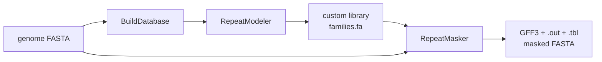

# RepeatMaskerWF — de novo repeat annotation with RepeatModeler + RepeatMasker

A [Snakemake](https://snakemake.github.io/) workflow that builds a de novo repeat
library from a genome assembly with **RepeatModeler**, then annotates and masks
the genome with **RepeatMasker** using that custom library.

## Pipeline



## Requirements

- Snakemake ≥ 7 (`pip install snakemake` or via conda/mamba)
- Conda (or Mamba/Miniforge) for `--use-conda`

## Setup

1. Put your genome assembly (FASTA) into `genomes/`, e.g. `genomes/genome.fa`.
2. Point `genome_fasta` in `config/config.yaml` at it.
3. Adjust `threads` and tool options as needed.

## Usage

```bash
# dry run
snakemake -n --use-conda

# full run (8 cores)
snakemake --use-conda --cores 8
```

Outputs are written to `results/`:

| File | Description |
|------|-------------|
| `results/<sample>-families.fa` | de novo repeat library (RepeatModeler consensus sequences) |
| `results/<sample>.repeatmasker.gff` | repeat annotations in GFF3 |
| `results/<sample>.repeatmasker.out` | RepeatMasker main table |
| `results/<sample>.repeatmasker.tbl` | summary table |
| `results/<sample>.masked.fa` | soft/hard-masked genome |

## Configuration

See [config/config.yaml](config/config.yaml). Key options:

- `genome_fasta` — path to the input assembly
- `threads` — cores used by RepeatModeler/RepeatMasker
- `repeatmodeler.engine` — search engine for RepeatModeler (`ncbi`, `abblast`, `rmblast`)
- `repeatmasker.search_engine` — search engine for RepeatMasker (`ncbi`, `abblast`, `rmblast`, `hmmer`)
- `repeatmasker.species` — optional; if set, RepeatMasker additionally uses the
  Dfam/Repbase library for the given species instead of only the custom library

## Notes

- The RepeatMasker rule passes the RepeatModeler library via `-lib`, so no
  bundled Dfam/Repbase databases are required for the default configuration.
- Conda environments are defined per rule in `workflow/envs/`.
